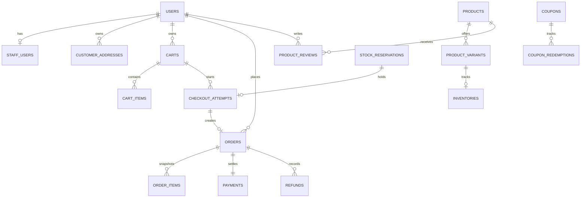
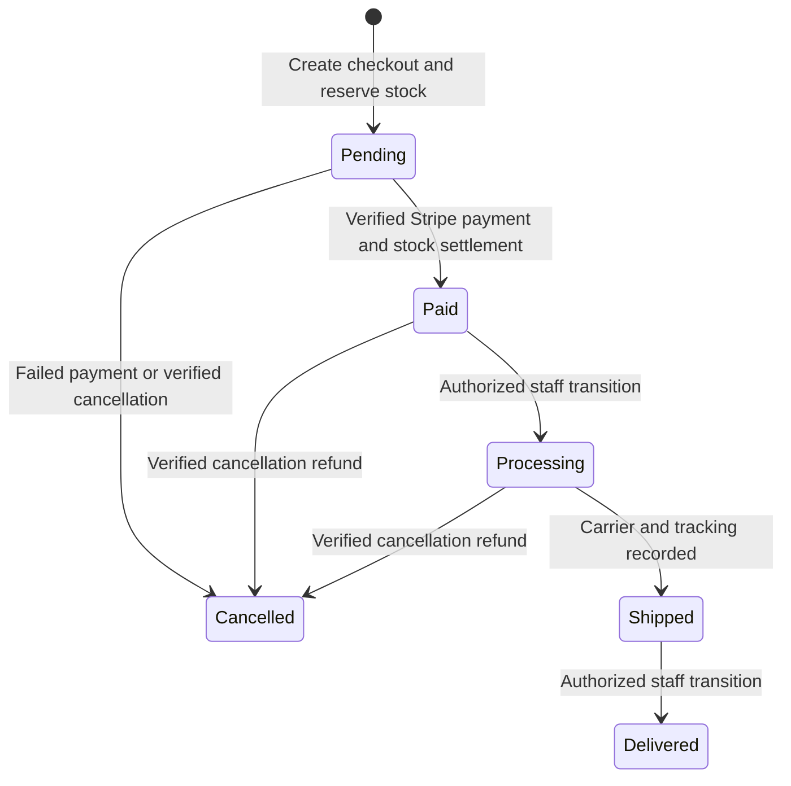

# API operations

## Authentication and deployment

Configure the two exact browser origins in `STOREFRONT_ORIGIN` and `ADMIN_ORIGIN`. API authentication uses scoped bearer tokens with a 24-hour expiry. Keep tokens in application memory where practical. Use HTTPS in production. Set `APP_ENV=production`, `APP_DEBUG=false`, `SESSION_SECURE_COOKIE=true`, and keep `APP_KEY`, database credentials, and Stripe keys in the deployment secret store. CORS excludes credentialed requests. Browser clients should send their tokens through the `Authorization` header.

Run migrations and the staff-access seeder on a prepared database, then bootstrap the first Super Admin from an interactive deployment console. Run a queue worker and invoke Laravel's scheduler every minute. Serve only the `public` directory. Use `php artisan queue:failed --no-interaction` and `php artisan payments:receipt-status --no-interaction` to inspect failed work. After correcting the underlying issue, retry a failed job by its queue UUID. Treat API error responses and the `X-Request-Id` header as the starting point for log correlation.

The GitHub Actions workflow runs MySQL migration and rollback, seeders, PHP style and static analysis, backend tests, OpenAPI validation, dependency audits, and frontend checks. Production deployment uses a separate environment and excludes local demo accounts and data.

## Default staff access

| Role | Default access |
| --- | --- |
| Super Admin | All permissions, including staff and role management |
| Admin | Catalog, inventory, order operations, customers, coupons, CMS, reports, reviews, and shipping settings |
| Product Manager | Catalog and inventory operations, order reads, content reads, and reports |
| Order Manager | Order updates and refunds, customer and coupon reads, reports, and audit reads |
| Support | Catalog, customer, and order reads with order note permission |

The exact grants are defined in [staff access configuration](../config/staff-access.php). Staff routes use the staff bearer guard and permission gates. Customer and public product routes use their own access rules.

## Data relationships

## Order transitions

Late payment and settlement exceptions are tracked separately from fulfillment. The reconciliation job requests a refund where the captured charge is verified. Unprocessed webhook receipts are recovered by the scheduler. Exhausted jobs appear in the failed queue and receipt status counts.
